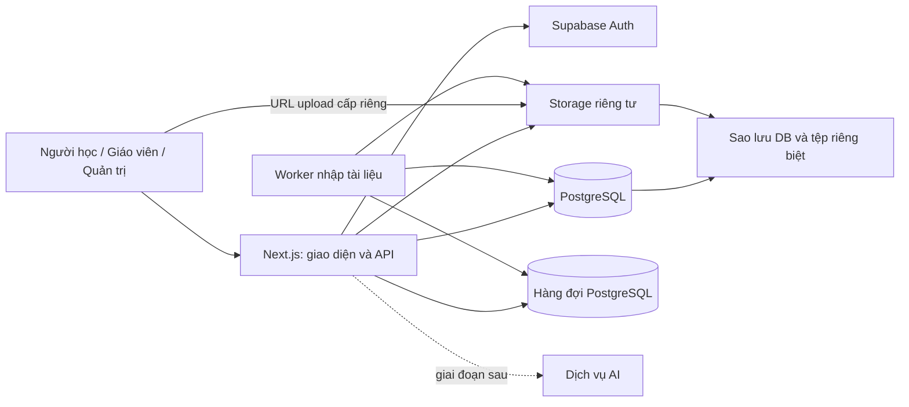
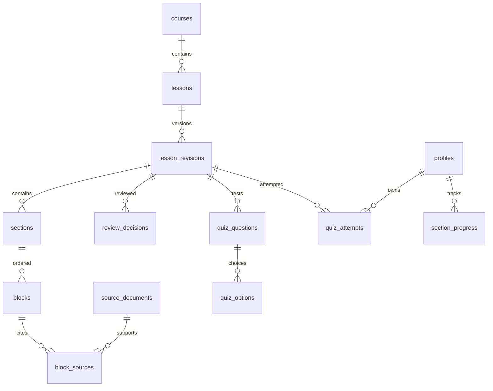
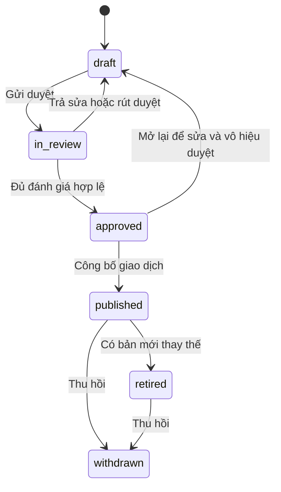

# Thiết kế hệ thống Kho học liệu số

**Phiên bản 1.0 · Ngày 07/10/2026**  
Dành cho chủ dự án, lập trình viên, giáo viên và người kiểm thử tiếp cận.  
Mã nguồn đối chiếu: commit `00c9d66`, repository `minhhieu0147896-web/Xay_Dung_Kho_Hoc_Lieu_So`.  
**Trạng thái: thiết kế để triển khai.** Các API, bảng và quy trình mới trong tài liệu chưa được cài đặt. Không coi đây là chứng nhận hệ thống đã có backend hoặc đạt chuẩn tiếp cận.

## Mục lục

1. [Quyết định và phạm vi](#1-quyết-định-và-phạm-vi)
2. [Kiến trúc](#2-kiến-trúc)
3. [Dữ liệu và phiên bản](#3-dữ-liệu-và-phiên-bản)
4. [Đăng nhập và phân quyền](#4-đăng-nhập-và-phân-quyền)
5. [Biên tập và công bố](#5-biên-tập-và-công-bố)
6. [Nhập tài liệu và lưu tệp](#6-nhập-tài-liệu-và-lưu-tệp)
7. [Hợp đồng API](#7-hợp-đồng-api)
8. [Học tập, tìm kiếm và AI](#8-học-tập-tìm-kiếm-và-ai)
9. [Tiếp cận](#9-tiếp-cận)
10. [Vận hành và sao lưu](#10-vận-hành-và-sao-lưu)
11. [Di trú dữ liệu](#11-di-trú-dữ-liệu)
12. [Cấu trúc mã và kiểm chứng](#12-cấu-trúc-mã-và-kiểm-chứng)
13. [Quyết định còn cần đầu vào](#13-quyết-định-còn-cần-đầu-vào)

Đọc mục 1–2 để hiểu phương án; mục 3–8 để triển khai; mục 9–12 để kiểm thử/vận hành. Công việc cụ thể nằm trong [kế hoạch triển khai](implementation-plan.md).

## 1. Quyết định và phạm vi

**Chọn Next.js hiện có + Supabase PostgreSQL, Auth và Storage; thêm một worker xử lý tài liệu chạy nền.** Cùng một kho mã, tổ chức thành các mô-đun nghiệp vụ. Ban đầu dùng hàng đợi PostgreSQL, chưa thêm Redis, CMS riêng hoặc nhiều dịch vụ độc lập.

Supabase có PostgreSQL làm nền cho Auth và Storage. Phương án này giảm số thành phần phải tự vận hành; không khẳng định luôn rẻ nhất. Dùng SQL migrations và Supabase SDK, chưa thêm ORM để tránh hai nơi cùng quản lý schema. [Tài liệu nền tảng](https://supabase.com/docs/guides/database/overview).

Ưu tiên: **lưu dùng chung và quyền thật → học liệu đúng nguồn, đọc được → tiến độ/quiz → hỏi đáp được kiểm chứng → mở rộng môn**. AI sinh câu trả lời là giai đoạn sau, không chặn việc đọc/nghe/luyện tập.

### Hiện trạng đã đối chiếu

| Thành phần | Đã có | Cần xây dựng |
|---|---|---|
| Ứng dụng | Next.js 16.3.5, React 19.2.8, TypeScript | Kết nối Supabase, lớp dữ liệu máy chủ |
| Học liệu | Mục lục 17 bài Lịch sử 12; Bài 6/10 có văn bản mẫu | Nhập SGK thật, nguồn và phiên bản đã đối chiếu |
| Biên tập | Khối văn bản/danh sách/hình/bảng, xem trước | Lưu nháp dùng chung, duyệt và lịch sử bất biến |
| Lưu trữ | JSON khởi tạo, localStorage cho dữ liệu sửa | DB + Storage + sao lưu |
| Nhập tài liệu | PDF có chữ, DOCX, TXT, JSON | Upload riêng tư, giới hạn tài nguyên, công việc chạy nền |
| Tài khoản | Chọn tài khoản demo | Auth và phân quyền thực tế |
| Hỏi đáp | Truy hồi từ khóa có nguồn | Tìm kiếm DB; AI chỉ sau đánh giá riêng |
| Quiz/tiến độ | Lưu trong trình duyệt, đáp án ở client | Chấm phía máy chủ, đồng bộ theo người dùng |

Mã đối chiếu: `app/data/content.ts`, `app/services/content.ts`, `app/services/learning.ts`, `app/api/import-document/route.ts`, `app/components/learning-app.tsx`. Route nhập PDF/Word hiện bị khóa trong production. Không bỏ khóa chỉ để upload hoạt động khi chưa có kiểm quyền thay thế.

### Giả định và giới hạn

- Một đơn vị vận hành kho chung; chưa có dữ liệu nhiều trường cách ly. Nếu cần, bổ sung tổ chức và xét lại toàn bộ quyền trước khi nhận dữ liệu trường thứ hai.
- Pilot bắt đầu Lịch sử lớp 12, Kết nối tri thức. Môn chưa có nội dung phải hiện trạng thái trống. Không coi mục lục là đã nhập SGK.
- Giữ giao diện trắng, điều hướng trên, mục lục trái/nội dung giữa/cách học phải; không đổi thiết kế rộng trong đợt backend.
- Khách xem danh mục; người đăng nhập đọc bản công bố. PDF sách gốc không tự động chia sẻ cho học sinh.
- Quy mô giả định để thử tải: 1.000 tài khoản, 50 người học hoạt động đồng thời, 10 người biên tập, 500 bài. Đây là đầu vào thiết kế, chưa phải năng lực đã đo.
- Ngoài MVP: thi chính thức, thanh toán, lớp học trực tuyến, video tự lưu dung lượng lớn, gõ đồng thời, ngoại tuyến đầy đủ, OCR và AI sinh câu trả lời.
- Ngân sách, region, tài khoản sở hữu hạ tầng, tài liệu SGK và người duyệt là đầu vào triển khai, không tự suy đoán hoặc mua dịch vụ.

## 2. Kiến trúc



**Trình duyệt:** hiển thị, nhập đáp án, đọc TTS, giữ trạng thái chuyển tab. Không chứa khóa quản trị, quyền tự khai hoặc đáp án đúng trước nộp. localStorage chỉ là bộ đệm/bản chưa gửi, không quyết định nội dung công bố.

**Next.js:** Server Components lấy dữ liệu ban đầu; Client Components xử lý tương tác. Route Handlers xác thực và validation, gọi dịch vụ nghiệp vụ. Theo hướng dẫn Next.js cài trong `node_modules/next/dist/docs/`; không dùng mẫu API từ phiên bản cũ. Đã đối chiếu tài liệu Server/Client Components và Route Handlers tại chỗ, gồm quy tắc tham số route động dạng Promise.

**PostgreSQL:** nguồn dữ liệu chính cho nội dung, quyền, phiên bản và tiến độ. Công bố, chấm quiz, cấp quyền là giao dịch; không gọi nhiều lệnh ghi độc lập từ client.

**Storage:** giữ PDF/Word gốc, ảnh, âm thanh. DB giữ định danh/metadata/đường dẫn, không nhét tệp base64 vào bảng.

**Worker:** tiến trình riêng cùng kho mã; trích xuất có thời hạn và giới hạn bộ nhớ, không giữ một HTTP request chờ parser lâu. Bắt đầu một worker và hàng đợi DB, tăng worker khi thử tải cho thấy cần.

Luồng đọc: chọn môn/sách → tìm bài → đọc/nghe → hỏi → mở đúng nguồn → quiz → lưu tiến độ. Luồng biên tập: chọn bài → nháp → nhập/sửa → kiểm tra → gửi duyệt → công bố. Bản học sinh đã mở giữ revision đang đọc; có thông báo bản mới, không tự thay nội dung giữa lúc làm bài.

URL bài mục tiêu: `/hoc/<lessonId>?revision=<uuid>#source-<blockKey>`. Không truyền revision thì lấy bản hiện hành. Trích dẫn luôn có revision; bản bị thu hồi trả thông báo phù hợp, không âm thầm mở đoạn mới.

## 3. Dữ liệu và phiên bản

### 3.1 Quy ước

UUID dùng cho tài khoản, revision, asset, công việc và lần làm quiz. Giữ lesson ID, section key, block key, question key dạng text để tương thích dữ liệu cũ. Thời gian dùng `timestamptz` UTC, hiển thị theo múi giờ người dùng. `position` từ 0, duy nhất trong cùng cha; thay thứ tự bằng giao dịch.

Quan hệ/quyền dùng bảng và khóa ngoại. Nội dung khác nhau theo loại khối dùng JSONB có schema, không lưu toàn bộ ứng dụng thành một JSON lớn. `body` cũ là văn bản sinh từ blocks, không phải nguồn sửa độc lập. Snapshot đã gửi duyệt không bị sửa trực tiếp.

### 3.2 Danh mục và tài khoản

| Bảng | Trường/khóa chính | Quy tắc |
|---|---|---|
| profiles | user_id FK Auth, display_name, status, timestamps | Không lưu mật khẩu; active/disabled |
| user_roles | PK(user_id,role) | student/teacher/admin; chỉ nghiệp vụ quản trị ghi |
| subjects | id, name, slug | slug duy nhất |
| book_series | id, name | Ví dụ Kết nối tri thức |
| courses | UUID, subject_id, grade, series_id, edition_label, locale | Unique môn/lớp/bộ/phiên bản; grade 1–12 |
| chapters | UUID, course_id, title, position | Unique course/position |
| course_editors | PK(course_id,user_id) | Người được giao phải có vai trò teacher/admin |
| lessons | text ID, course_id, chapter_id, lesson_number, catalog_title, current_revision_id nullable | Unique course/số bài; chapter và revision thuộc đúng course/bài |

Tên bài trong mục lục tách khỏi tiêu đề diễn giải của bản đọc. Chưa có sách để đối chiếu thì edition_label=`unverified`, không tự gán năm xuất bản. Phiên bản sách khác tạo course khác để không làm mất lịch sử.

### 3.3 Nội dung và nguồn

| Bảng | Trường/khóa chính | Quy tắc |
|---|---|---|
| lesson_revisions | UUID, lesson_id, revision_no, base_revision_id, status, content_kind, title, summary, author_id, edit_version, content_hash, timestamps | Unique lesson/revision_no; kind demo/textbook/adaptation |
| sections | PK(revision_id,section_key), heading, position | Unique revision/position |
| blocks | PK(revision_id,block_key), section_key, position, type, payload JSONB, plain_text | FK mục cùng revision; unique revision/mục/position |
| source_documents | UUID, course_id, title, edition, publisher, source_type, reference_url, asset_id, rights_status, rights_note | pending/approved/restricted; nguồn đang được trích dẫn không ghi đè lịch sử |
| block_sources | UUID, revision_id, block_key, source_id, printed_page, file_page, locator | FK khối cùng revision; có cách định vị phù hợp loại nguồn |
| lesson_resources | UUID, revision_id, kind, asset_id, youtube_video_id, transcript, visual_description | Media/video đúng loại; nguồn gắn qua resource_sources |
| resource_sources | PK(resource_id,source_id), locator | Truy vết video/âm thanh/tài liệu bổ sung tới nguồn |
| review_decisions | UUID, revision_id, content_hash, reviewer_id, category, decision, notes, evidence, created_at | category content/accessibility; gắn snapshot cụ thể |
| private.audit_events | UUID, actor_id nullable, action, entity_id, request_id, metadata, created_at | Append-only; không chứa token/toàn văn tài liệu |

`content_hash` do máy chủ tính từ metadata học tập, các khối, nguồn, media/transcript và quiz theo thứ tự chuẩn; không gồm timestamps/status. Mọi sửa đổi liên quan làm mất hiệu lực duyệt cũ. `plain_text` sinh từ payload, không nhận tùy ý từ client.

`printed_page` là nhãn trang (“iv”, “42–43”); `file_page` là số thứ tự trang tệp >=1. Nguồn web dùng mục/đoạn trong locator; video dùng khoảng thời gian. Nội dung tự biên soạn ghi rõ tác giả/căn cứ, không bắt có số trang giả. Một khối có thể có nhiều nguồn.

### 3.4 Quiz và tiến độ

| Bảng | Trường/khóa chính | Quy tắc |
|---|---|---|
| quiz_questions | PK(revision_id,question_key), position, prompt, section_key | FK mục cùng revision; không chứa đáp án đúng |
| quiz_options | PK(revision_id,question_key,option_key), text, position | FK câu hỏi |
| private.quiz_keys | PK(revision_id,question_key), correct_option_key, explanation, source_block_key nullable | FK đáp án/khối cùng revision; học sinh không đọc trực tiếp |
| quiz_attempts | UUID, user_id, revision_id, state, score nullable, started_at, submitted_at | in_progress/submitted; điểm do máy chủ ghi |
| attempt_answers | PK(attempt_id,question_key), revision_id, option_key, edit_version | FK attempt/revision và option; đã nộp không sửa |
| section_progress | PK(user_id,revision_id,section_key), completed, edit_version, updated_at | FK mục đúng revision, chỉ chủ sở hữu sửa |
| reading_positions | PK(user_id,lesson_id), revision_id, section_key, block_key, edit_version | Các tham chiếu thuộc cùng bài/revision |
| user_preferences | PK user_id, font_scale, high_contrast, speech_rate, reduced_motion, edit_version | Chỉ chủ sở hữu, giá trị có giới hạn |
| private.legacy_progress_imports | user_id, batch_id, lesson_id, source_payload, imported_at | Điểm demo nhập về có nhãn riêng, không phải điểm chấm server |

Giữ tiến độ theo revision. Chỉ kế thừa mục đã đọc khi section key và hash nội dung mục không đổi; vẫn giữ bản cũ. Quiz bản mới là lần làm mới, không gán điểm cũ sang câu hỏi đã sửa. MVP là luyện tập tự học, không phải thi chống gian lận.

### 3.5 Tệp, công việc và nhập dữ liệu cũ

| Bảng | Trường chính | Quy tắc |
|---|---|---|
| assets | UUID, owner_id, course_id, bucket, object_path, original_name, mime, bytes, sha256, state, created_at | uploading/quarantined/ready/rejected; path duy nhất |
| revision_assets | PK(revision_id,asset_id), purpose | Ràng buộc tài sản được revision sử dụng |
| private.import_jobs | UUID, requester_id, lesson_id, asset_id, page_range, state, attempt_count, lease_until, worker_token, result_path, applied_revision_id, error_code, created_at | Nhận việc/retry có khóa và lease; áp dụng tối đa một lần |
| private.idempotency_keys | PK(actor_id,operation,key), request_hash, status, result_ref, expires_at | Gửi lại không sinh tác dụng hai lần |
| private.migration_batches | UUID, actor_id, source_hash, mapping, result, created_at | Báo cáo ánh xạ và ngăn nhập trùng |



Sơ đồ chỉ thể hiện quan hệ chính; bảng trên là đặc tả MVP. Dùng FK tổng hợp để ngăn lấy đoạn bài A gắn revision bài B. Các block_sources/resource_sources phải thuộc nguồn cùng course với revision; revision_assets và payload ảnh phải tham chiếu asset ready đúng course. Cưỡng chế bằng FK tổng hợp hoặc trigger kiểm bất biến, không chỉ validation UI. Index khóa ngoại và các truy vấn course/số bài, lesson/status, user/updated_at, job/state/lease_until. Không tạo index hàng loạt khi chưa đo truy vấn.

## 4. Đăng nhập và phân quyền

| Hành động | Khách | Học sinh | Giáo viên được giao course | Quản trị |
|---|---|---|---|---|
| Xem danh mục | Có | Có | Có | Có |
| Đọc bản được công bố | Không | Có | Có | Có |
| Xem nháp/tệp gốc | Không | Không | Trong course được giao | Có |
| Sửa nháp/nhập tệp | Không | Không | Trong course được giao | Có |
| Duyệt/công bố/thu hồi | Không | Không | Không ở MVP | Có, kèm bằng chứng kiểm tra |
| Xem/sửa tiến độ | Không | Của mình | Của mình | Không mặc định xem cá nhân |
| Quản lý vai trò/phạm vi biên tập | Không | Không | Không | Có |

Pilot dùng email/mật khẩu và khôi phục mật khẩu; quản trị mời tài khoản. Không có tự đăng ký làm giáo viên. Bộ chọn tài khoản demo chỉ còn trong chế độ demo tách biệt. Không lưu mật khẩu trong profiles. Quyền admin không tự chứng minh năng lực duyệt môn học.

API xác minh phiên bằng cơ chế Supabase SSR hiện hành; không tin session đọc thô từ cookie. Đọc quyền từ bảng do máy chủ quản lý, không từ form hoặc metadata người dùng tự sửa. Thu hồi quyền được kiểm ở thao tác kế tiếp. [Hướng dẫn SSR](https://supabase.com/docs/guides/auth/server-side/nextjs).

Bật RLS trên mọi bảng expose, thiết lập cả grants lẫn policy; mặc định từ chối. Học sinh đọc revision published/retired còn được phép và dữ liệu riêng. Giáo viên đọc nháp theo course_editors. Schema private không expose qua Data API. [RLS và grants](https://supabase.com/docs/guides/database/postgres/row-level-security).

Đọc thường dùng client gắn JWT người dùng; không dùng service-role cho tất cả request. Ghi nhiều bảng qua RPC có kiểm auth.uid(), tài khoản active, quyền course, trạng thái và tham số. Với SECURITY DEFINER: search_path rỗng, tên schema đầy đủ, thu hồi EXECUTE mặc định, cấp đúng vai trò. Quyền ghi bảng nội dung/điểm/role trực tiếp bị thu hồi; các RPC là đường ghi nghiệp vụ. Cần kiểm chính RPC không mở đường vượt RLS.

Khóa publishable phía client không thay quyền. Secret/service-role và kết nối DB chỉ ở máy chủ, không đặt biến NEXT_PUBLIC_. Mutation xác minh Origin/CSRF phù hợp cookie, giới hạn tốc độ. Không trả chi tiết tài nguyên ngoài quyền người gọi. Admin không mặc định xem lịch sử học cá nhân; chỉ thêm chức năng đó khi có nhu cầu/quy trình cụ thể.

## 5. Biên tập và công bố



Chỉ draft được sửa nội dung. Trả về draft tăng edit_version, vô hiệu duyệt cũ; bản approved muốn sửa phải chuyển về draft qua thao tác có audit và vô hiệu đánh giá. Bản đã published/retired không sửa: tạo draft mới từ snapshot. Mỗi bài tối đa một revision ở draft/in_review/approved, cưỡng chế bằng unique index có điều kiện.

Duyệt content và accessibility lưu người kiểm, hash, thời điểm, ghi chú, bằng chứng. Có thể cùng một người đủ năng lực làm hai đánh giá, nhưng khác tác giả revision. Checkbox tác giả không thay được đánh giá. Nguồn/tệp phải hợp lệ và ready; content_kind=demo vẫn giữ nhãn mẫu sau công bố.

Thuật toán `publish_revision` dưới đây là **mã giả thiết kế**, không phải migration đã chạy:

```text
BEGIN TRANSACTION
  xác thực actor và quyền công bố
  khóa hàng lesson bằng SELECT FOR UPDATE
  nếu idempotency key hoàn tất: trả cùng kết quả
  so expectedCurrentRevisionId với con trỏ hiện tại; khác -> 409
  kiểm revision thuộc bài, approved, hash không đổi
  kiểm hai review cùng hash, reviewer khác author, source/asset hợp lệ
  đổi bản cũ published -> retired nếu có
  đổi bản mới approved -> published; ghi thời điểm máy chủ
  cập nhật lessons.current_revision_id
  ghi audit và kết quả idempotency trong cùng giao dịch
COMMIT
  làm mới cache của bài; thất bại thì retry
```

Cấp revision_no dưới khóa bài, không tính max+1 ngoài giao dịch. Mọi đường sửa phải kiểm trạng thái trong DB, không chỉ disable nút. Lưu nháp có expectedEditVersion; câu UPDATE chỉ thành công khi version khớp rồi tăng một. Người thứ hai nhận 409, được xem bản mới hoặc xuất bản đang sửa; không âm thầm ghi đè.

Thu hồi hiện hành phải đồng thời đặt current_revision_id null hoặc chuyển tới bản còn hợp lệ được chọn, kèm lý do/audit. Không tự bật lại bản đã thu hồi. Trích dẫn revision withdrawn trả 410. Khôi phục nội dung cũ tạo draft mới rồi duyệt; không sửa snapshot cũ.

## 6. Nhập tài liệu và lưu tệp

### 6.1 Luồng đầy đủ

1. Giáo viên chọn bài/course, khai nguồn. API kiểm quyền/kích thước/loại và tạo asset, cấp URL upload vào path do máy chủ sinh.
2. Upload vào bucket riêng tư, không overwrite. Bước complete do máy chủ xác minh object, byte, chữ ký định dạng, checksum và kiểm tệp; không tin tên/Content-Type client. Asset ở quarantine tới khi đạt kiểm tra.
3. Tạo import job, trả 202 và jobId. Giao diện cho rời trang, xem lại tiến trình sau.
4. Worker trích xuất thành kết quả riêng tư. Thành công chỉ có nghĩa lấy được chữ; không có nghĩa đúng nội dung hay đã duyệt.
5. Giáo viên chọn Áp dụng vào nháp với expectedEditVersion. Nếu đã có sửa trong lúc chờ thì báo xung đột; không ghi đè tự động.
6. Đối chiếu tệp gốc, sửa thứ tự, gán nguồn/trang, nhập hình/bảng rồi lưu/gửi duyệt.

PDF dùng unpdf; DOCX dùng Mammoth trích văn bản, sau rà soát phiên bản và lỗ hổng. PDF scan chuyển needs_ocr; OCR ngoài MVP. Không gửi tài liệu sang dịch vụ khác khi chưa chọn nhà cung cấp/phạm vi dữ liệu. TXT/JSON cũng phải qua validation/quyền khi lưu server; JSON không được mang theo quyền hay tự đặt trạng thái công bố.

### 6.2 Worker, retry và giới hạn

Job: queued → running → succeeded/needs_ocr/failed/cancelled. Claim bằng transaction và FOR UPDATE SKIP LOCKED; tăng attempt_count, cấp worker_token và lease. Gia hạn lease khi chạy; chỉ worker còn token đúng được ghi kết quả. Lease hết thì được nhận lại, tối đa ba lần, thời gian chờ tăng; lỗi định dạng/tệp không retry vô ích. Kết quả theo jobId nên chạy lại không tạo nhiều nháp. Apply khóa hàng job và draft trong một giao dịch, kiểm applied_revision_id rỗng rồi ghi khối và dấu đã áp dụng; cùng job không áp dụng lần hai dù dùng idempotency key khác. Hủy job ngăn apply; worker kiểm token/trạng thái trước ghi.

Giới hạn đề xuất khởi đầu: 10 MB/tệp, 30 trang PDF/lần, 150.000 ký tự kết quả, hai job chờ/chạy mỗi giáo viên; một worker xử lý một job, timeout 120 giây và bộ nhớ 512 MB. Phải thử fixture/tải để điều chỉnh; không bảo đảm mọi tệp đều đọc được.

Parser chạy tiến trình con có thể dừng, không mạng ra ngoài, không macro. DOCX cần giới hạn dung lượng giải nén/số entry, PDF kiểm trang/tệp khóa. Quét tệp trước cho người khác tải; định dạng nguy hiểm hoặc ảnh SVG chưa làm sạch không được render tùy ý. Không lấy HTML chuyển đổi từ tài liệu đưa thẳng vào DOM.

Lỗi có mã: FILE_TOO_LARGE, UNSUPPORTED_FORMAT, CORRUPT_DOCUMENT, PASSWORD_REQUIRED, NO_EXTRACTABLE_TEXT, PAGE_RANGE_INVALID, IMPORT_TIMEOUT, DRAFT_CONFLICT. Giữ bản sửa khi lỗi, chỉ báo lưu thành công sau xác nhận server.

### 6.3 Bucket và quyền tệp

```text
source-originals/{courseId}/{assetId}/original.pdf
lesson-media/{courseId}/{assetId}/image.webp
lesson-audio/{courseId}/{assetId}/reading.mp3  # giai đoạn sau
import-results/{jobId}/extracted.json
```

Bucket đều private trong pilot; máy chủ cấp URL truy cập sau kiểm quyền, đề xuất sống 5 phút. URL đã cấp có thể còn dùng tới hết hạn dù quyền bị thu hồi; không hứa thu hồi tức thì đường dẫn đã phát. Lưu assetId/path, không lưu signed URL trong nội dung. [Private bucket và signed URL](https://supabase.com/docs/guides/storage/buckets/fundamentals).

Học sinh chỉ tải media gắn revision được đọc, không tự có quyền PDF gốc. Thay bytes tạo assetId mới, không overwrite path cũ. Upload dở/tệp lỗi dọn sau 24 giờ; không dọn tệp còn tham chiếu, chưa sao lưu hoặc đang được giữ vì lý do nghiệp vụ. Kết quả nhập giữ theo chính sách ở mục 10.

## 7. Hợp đồng API

Tất cả đường dưới đây là **API mục tiêu**, chưa tồn tại trong mã hiện tại. Prefix `/api/v1`. API Auth dùng Supabase thông qua luồng đăng nhập của ứng dụng. Lỗi trả tiếng Việt, mã ổn định và requestId.

| Method và endpoint | Quyền | Đầu vào/kết quả chính |
|---|---|---|
| GET /catalog | Khách | Lọc subject/grade/series/cursor; có/chưa có học liệu |
| GET /lessons/:id?revision= | Đăng nhập | Snapshot được phép, không đáp án đúng |
| GET /search?q=&courseId=&cursor= | Đăng nhập | Tối đa 20 đoạn/trang với citation |
| GET /authoring/lessons?courseId= | Giáo viên course/quản trị | Danh sách bài, nháp, trạng thái duyệt |
| GET /lessons/:id/revisions | Giáo viên course/quản trị | Lịch sử phiên bản và audit công bố |
| GET /drafts/:revisionId | Giáo viên course/quản trị | ContentDraft đầy đủ để biên tập |
| GET, POST /sources | Giáo viên course/quản trị | Lọc course, đọc/tạo metadata nguồn |
| PATCH /sources/:id | Giáo viên course/quản trị | Sửa nguồn chưa dùng; metadata nguồn đã dùng tạo bản nguồn mới |
| POST /admin/sources/:id/rights | Quản trị | Thay quyền sử dụng có lý do; thu hồi revision liên quan khi cần |
| POST /lessons/:id/draft | Giáo viên course | baseRevisionId; nháp mới hoặc nháp đang có |
| PUT /drafts/:revisionId | Giáo viên course | ContentDraft, expectedEditVersion; version/hash mới |
| POST /drafts/:id/submit | Giáo viên course | expectedEditVersion; đóng băng gửi duyệt |
| POST /revisions/:id/reopen | Tác giả course hoặc quản trị | expectedEditVersion, lý do; về draft nếu chưa công bố |
| POST /revisions/:id/reviews | Quản trị | category/decision/hash/notes/evidence |
| POST /lessons/:id/publish | Quản trị | revisionId, expectedCurrentRevisionId |
| POST /revisions/:id/withdraw | Quản trị | Lý do, con trỏ dự kiến, bản thay thế nullable |
| POST /assets/upload-intent | Giáo viên course | courseId/name/mime/size → assetId/URL |
| POST /assets/:id/complete | Chủ upload/quản trị | Yêu cầu xác minh, không tự đặt ready |
| GET /assets/:id/access | Theo nguồn/media | URL tạm, cache no-store |
| POST /imports | Giáo viên course | assetId/lessonId/phạm vi trang → 202 jobId |
| GET /imports/:id | Người tạo/quản trị | Trạng thái, cảnh báo, mã lỗi |
| POST /imports/:id/cancel | Người tạo/quản trị | Hủy khi chưa áp dụng |
| POST /imports/:id/apply | Giáo viên course | revisionId/expectedEditVersion, thêm vào nháp |
| GET /me/progress?lessonId= | Chính mình | Tiến độ của mình |
| PUT /me/progress/:revisionId/:sectionKey | Chính mình | completed/expectedEditVersion |
| PUT /me/reading-position | Chính mình | lesson/revision/section/block, expectedEditVersion |
| GET, PUT /me/preferences | Chính mình | Cỡ chữ, tương phản, TTS; PUT có expectedEditVersion |
| POST /quiz-attempts | Học sinh | revisionId → attemptId, câu hỏi không đáp án |
| PUT /quiz-attempts/:id/answers/:questionKey | Chủ attempt | optionKey/expectedEditVersion |
| POST /quiz-attempts/:id/submit | Chủ attempt | Khóa, chấm, trả điểm và giải thích |
| GET /quiz-attempts/:id | Chủ attempt | Lựa chọn đã lưu; lời giải chỉ sau submitted |
| POST /lessons/:id/ask | Đăng nhập | revisionId/question → mode/status/citations |
| POST /migration/preview, /migration/apply | Theo dữ liệu | Preview ánh xạ rồi nhập có báo cáo |
| POST /admin/invitations | Quản trị | Mời tài khoản pilot với vai trò ban đầu học sinh |
| POST /admin/users/:id/status | Quản trị | active/disabled, lý do và audit |
| POST /admin/users/:id/roles | Quản trị | Vai trò/lý do, ghi audit |
| PUT /admin/courses/:id/editors | Quản trị | Phân công giáo viên |

Mutation tạo job/apply/công bố/tạo và nộp attempt có Idempotency-Key UUID. Khóa gắn actor + operation + request hash, giữ 7 ngày. Cùng khóa khác payload trả 409. Hết hạn khóa vẫn kiểm trạng thái hoàn tất để tránh nộp/công bố hai lần. Không nhận userId/score/actorId tùy ý từ học sinh.

HTTP: 400 sai đầu vào; 401 chưa đăng nhập; 403 không được thao tác; 404 không có hoặc không được biết tài nguyên; 409 xung đột; 410 thu hồi; 413 quá lớn; 422 chưa đủ điều kiện; 429 quá giới hạn; 503 dịch vụ lỗi. Ví dụ:

```json
{
  "error": {
    "code": "DRAFT_CONFLICT",
    "message": "Bài đã được cập nhật. Hãy xem bản mới trước khi lưu tiếp.",
    "requestId": "example-request-id",
    "currentEditVersion": 8
  }
}
```

Hợp đồng TypeScript minh họa, chưa phải implementation; UUID cần validation runtime:

```ts
type UUID = string;
type SourceRef = {
  sourceId: UUID;
  printedPage?: string;
  filePage?: number;
  locator?: string;
};
type BlockPayload =
  | { type: "paragraph"; text: string }
  | { type: "list"; ordered: boolean; items: string[] }
  | { type: "image"; assetId: UUID; alt: string;
      caption: string; complex: boolean; longDescription: string }
  | { type: "table"; caption: string; headers: string[];
      rows: string[][]; firstColumnIsRowHeader: boolean };
type ContentBlock = {
  key: string;
  position: number;
  payload: BlockPayload;
  sources: SourceRef[];
};
type Citation = {
  lessonId: string;
  revisionId: UUID;
  sectionKey: string;
  blockKey: string;
  excerpt: string;
  sources: SourceRef[];
};
type AskResponse = {
  mode: "retrieval" | "generated";
  status: "ok" | "insufficient_evidence" | "unavailable";
  text: string;
  citations: Citation[];
};
```

ContentDraft có metadata, sections/blocks, sources, resources và quiz riêng cho giáo viên. DTO học sinh tách riêng, không serialize quiz_keys. Payload có schemaVersion, giới hạn byte/độ dài/số khối và trường cho phép. Validation Zod ở API, constraints/RPC ở DB. Nội dung luôn escape khi render, không dùng HTML thô từ tài liệu.

Contract tests kiểm cả trường không được trả: correctOption/explanation trước nộp, email người khác, token, path sách gốc. Quyền đọc revision được kiểm trước tìm kiếm/hỏi đáp, không lọc sau khi đã gửi dữ liệu tới mô hình.

## 8. Học tập, tìm kiếm và AI

### Tiến độ và luyện tập

Tạo attempt gắn revision, lưu từng lựa chọn khi đổi đáp án. UI giữ trạng thái trong lúc chuyển Đọc bài/Hỏi đáp/Luyện tập; phản hồi “đang lưu/đã lưu/lỗi” phải đúng thực tế. Nộp quiz khóa attempt trong giao dịch, kiểm mọi đáp án thuộc câu hỏi của revision, chấm bằng private.quiz_keys rồi ghi submitted/score. Gửi lại cùng yêu cầu trả kết quả cũ. Sau nộp mới cấp lời giải; làm lại tạo attempt mới.

Đánh dấu mục đọc, vị trí và tùy chọn có version chống ghi đè. Hai thiết bị cập nhật từ cùng version: trả xung đột, tải trạng thái server, cho người dùng thử lại hành động. Không dùng đồng hồ client để quyết định bản thắng. Bản chưa gửi có thể lưu cục bộ theo tài khoản; đăng xuất không để người dùng kế tiếp thấy bản của người trước. Pilot chưa có đồng bộ ngoại tuyến tự động: khi mất mạng phải báo rõ và giữ thao tác chưa gửi.

### Tìm kiếm và hỏi đáp MVP

Tìm theo course/bản công bố, chuẩn hóa chữ thường/không dấu/đ→d và giữ nguyên bản gốc để hiển thị. PostgreSQL thực hiện truy vấn tham số hóa; chọn chỉ mục chuỗi hoặc full-text sau thử bộ truy vấn tiếng Việt, không giả định stemming tiếng Việt hoạt động sẵn. Phân trang tối đa 20 kết quả, mỗi kết quả có revision và blockKey.

Hỏi đáp từ khóa trả đoạn có chứng cứ hoặc insufficient_evidence. Không lấy sự khớp với câu hỏi quiz làm bằng chứng rằng đoạn chứa câu trả lời. Nhãn “truy hồi từ khóa” giữ rõ; không gọi là RAG sinh câu trả lời. Đọc bản cũ đã thu hồi phải bị chặn cả ở tìm kiếm lẫn hỏi đáp.

### Giai đoạn AI sau MVP

Chia đoạn theo cấu trúc và nguồn; giữ lesson/revision/block/phiên bản embedding. Có thể bổ sung embedding trong PostgreSQL sau đánh giá, chưa cần vector DB riêng. Truy hồi đúng quyền trước, gửi phần context cần thiết tới mô hình, kiểm schema phản hồi và mọi citation thuộc tập đã cung cấp. Citation có ID hợp lệ chưa chứng minh câu trả lời được nguồn hỗ trợ: cần giáo viên đánh giá nội dung.

Tài liệu nhập là dữ liệu, không là chỉ thị cho AI. Mô hình không có quyền ghi DB, công bố hay cấp vai trò. Không thực hiện yêu cầu có trong tài liệu như tiết lộ prompt, gửi dữ liệu hoặc mở URL. Chưa chốt nhà cung cấp/ngân sách/chính sách dữ liệu thì mode generated bị tắt. AI lỗi hoặc hết hạn mức vẫn đọc/nghe/luyện tập được. Bộ đánh giá phải có câu hỏi thiếu nguồn, dẫn dụ và mâu thuẫn phiên bản; không chỉ câu dễ đã biết đáp án.

## 9. Tiếp cận

Mục tiêu thiết kế là WCAG 2.2 mức AA cho luồng MVP, chưa phải tuyên bố đạt chuẩn. WCAG quy định nội dung thông thường thích ứng ở bề rộng tương đương 320 CSS px; phần cần bố cục hai chiều như bảng có ngoại lệ phù hợp. [WCAG 2.2](https://www.w3.org/TR/WCAG22/).

Yêu cầu cụ thể của sản phẩm:

- Giữ chữ giao diện mặc định 16px, bài đọc 18px; thử tăng chữ 200% và zoom 400%. Chế độ chữ lớn là bổ sung.
- Landmark, heading và thứ tự DOM hợp lý; màn hình nhỏ thu gọn điều hướng phụ, không nhân đôi các control cho screen reader. Giao diện không mất chức năng ở 320 CSS px.
- Mọi thao tác bằng Tab/Shift+Tab/Enter/Space; sửa thứ tự có nút lên/xuống, không chỉ kéo thả. Focus rõ, không kẹt hoặc bị thanh cố định che.
- Mở bài focus tên bài; mở nguồn focus đúng đoạn; đóng hộp thoại trả focus về nút mở. Chuyển mục giữ câu hỏi/câu trả lời/lựa chọn.
- Thông báo trạng thái qua vùng live phù hợp; không đọc lại toàn trang hay phát liên tục mỗi ký tự. Lỗi gắn trường và có tóm tắt điều hướng được.
- Hình có alt đúng ý nghĩa; bản đồ/biểu đồ có mô tả dài hoặc dữ liệu tương đương. Không chỉ kiểm chuỗi alt khác rỗng.
- Bảng có caption/header đúng vai trò; tách bảng phức tạp hoặc có bản diễn giải. Không tự coi cột đầu là header khi dữ liệu không như vậy.
- TTS theo khối, có dừng/tạm dừng/tốc độ, không tự phát. Tránh thông báo trùng khi screen reader đang đọc; thiếu giọng tiếng Việt vẫn dùng được bài bằng công nghệ hỗ trợ.
- Video có phụ đề/chép lời; thông tin quan trọng chỉ có trên hình phải có mô tả hoặc thuyết minh phù hợp. Transcript tự động chưa được coi là đã duyệt.
- Tùy chọn đọc lưu theo tài khoản; không cần thu thập chẩn đoán hay mức độ khuyết tật để bật hỗ trợ.

Công thức Toán/Lý/Hóa phải có thiết kế riêng trước nhập môn đó: biểu diễn ngữ nghĩa, văn bản cách đọc tiếng Việt và thử renderer MathML/screen reader thực tế. Không lấy ảnh công thức làm nội dung duy nhất. Lịch sử là pilot để hoàn thiện quy trình, không đại diện đủ mọi dạng học liệu.

Kịch bản nghiệm thu: NVDA + trình duyệt desktop từ đăng nhập → tìm Bài 6 → duyệt heading/mục → đọc đoạn/mô tả hình/bảng → hỏi → về đúng nguồn → quiz → tải lại tiếp tục. Người khiếm thị thử phóng đại và tương phản. Có một lượt với người học mù thực tế trước pilot cho nhóm mục tiêu, ghi trở ngại, sửa và thử lại. Kiểm tự động, bàn phím và thử với người dùng là các lớp khác nhau.

## 10. Vận hành và sao lưu

### 10.1 Môi trường, cấu hình và phát hành

Dev/staging/production có DB/bucket/khóa tách biệt. Không chép dữ liệu cá nhân production về demo. Một dịch vụ Node cho Next.js, một worker Node, Supabase quản lý DB/Auth/Storage; đặt gần nhau theo region đã chọn. Nhà cung cấp web/worker chốt theo ngân sách, không buộc Vercel.

Migrations trong Git, chạy trên staging trước production. Thêm cấu trúc tương thích → chuyển đọc/ghi → kiểm chứng → mới bỏ cấu trúc cũ. Không migrate trong HTTP request. CI gồm lint, typecheck, unit, DB/RLS, API, build và luồng trình duyệt chính. Quét secret/phụ thuộc; xử lý hoặc đánh giá các cảnh báo đã ghi trong content-authoring.md trước phát hành Internet, không audit fix --force mù quáng.

Cấu hình đề xuất (chỉ tên, không phải khóa thật):

| Biến | Phạm vi | Ý nghĩa |
|---|---|---|
| NEXT_PUBLIC_SUPABASE_URL | Client/server | Địa chỉ dự án |
| NEXT_PUBLIC_SUPABASE_PUBLISHABLE_KEY | Client/server | Khóa publishable, luôn cần phân quyền |
| SUPABASE_SECRET_KEY | Server hạn chế | Tác vụ đặc quyền được kiểm quyền; không dùng cho đọc thường |
| DATABASE_URL | Migrations/worker | Kết nối vai trò đúng mức quyền |
| APP_MODE | Server | demo hoặc connected, không fallback âm thầm |
| IMPORT_MAX_BYTES / IMPORT_TIMEOUT_MS | Server/worker | Giới hạn tài liệu |
| AI_ENABLED | Server | false cho MVP |

Vai trò worker chỉ đọc tệp/job liên quan và ghi kết quả nhập; không cấp quyền công bố. Đặc quyền quản trị Auth nếu cần mời tài khoản nằm trong mô-đun server riêng. Các sự kiện cấp quyền/duyệt/công bố/thu hồi/di trú ghi audit trong cùng giao dịch. Không log khóa, mật khẩu, toàn văn sách hoặc câu hỏi cá nhân.

### 10.2 Vòng đời dữ liệu

Thu tối thiểu email đăng nhập, tên hiển thị và dữ liệu học cần thiết. Chưa lưu lịch sử hỏi đáp lâu dài: chỉ trong phiên, log mã lỗi/độ trễ. Muốn lịch sử phải có lựa chọn và chính sách xóa.

Đề xuất pilot: upload dở/tệp lỗi 24 giờ; kết quả trích xuất 7 ngày sau áp dụng hoặc người tạo xác nhận không cần; log kỹ thuật 30 ngày; audit 180 ngày; tiến độ giữ khi tài khoản hoạt động. Các mốc cần chủ dự án chốt trước người dùng thật, không phải yêu cầu pháp luật được suy đoán.

Tài khoản có thể xuất dữ liệu cá nhân và yêu cầu xóa; thực hiện qua quy trình quản trị MVP có xác minh chủ sở hữu, báo cáo hoàn tất. Không xóa revision giáo viên đã biên tập theo cascade khi xóa tài khoản: FK tác giả cho phép khử liên kết, giữ thông tin tác giả công khai đã được phép sử dụng theo chính sách nguồn. Tiến độ/lựa chọn thuộc người bị xóa được dọn; audit khử liên kết khi phù hợp. Bản sao lưu có thời gian hết hạn riêng, không hứa xóa ngay khỏi mọi backup.

Quyền sử dụng tệp/SGK lưu trong rights_status/rights_note; việc upload không tự xác nhận quyền. Thu hồi nguồn tìm các revision/resource liên quan, cập nhật quyền đọc và tệp. Không công khai toàn bộ sách chỉ vì có URL Storage.

### 10.3 Sao lưu và khôi phục

Mục tiêu pilot đề xuất: RPO 24 giờ (mất dữ liệu tối đa), RTO 4 giờ (thời gian phục hồi). Phải diễn tập để xác nhận. Chọn gói/lịch backup thực sự đáp ứng, không mặc định gói miễn phí đáp ứng.

Backup DB và tệp riêng với manifest assetId/path/checksum, mã hóa và quyền hạn chế. Supabase database backup không bao gồm bytes của Storage. [Tài liệu backup](https://supabase.com/docs/guides/platform/backups).

Mỗi tháng khôi phục thử vào môi trường cách ly: DB + objects → kiểm hash/thiếu tệp → kiểm quyền → tài khoản thử → bài/nguồn/ảnh/quiz/progress → đo thời gian và số lỗi. Auth, SMTP, redirect URL và secrets có hướng dẫn phục hồi riêng; SQL dump không phải toàn bộ hệ thống.

Deploy lỗi: quay lại app tương thích và tạm khóa ghi nếu cần; không tự chạy migration phá dữ liệu để undo. Nội dung sai: thu hồi hoặc công bố bản sửa có lịch sử.

### 10.4 Hiệu năng, chi phí và giám sát

Theo dõi tỷ lệ lỗi, p95 API, tuổi job lâu nhất, retry/fail, dung lượng, lưu lượng tải, chi phí AI khi bật. Cảnh báo không đính kèm dữ liệu học riêng tư.

Mục tiêu thử tải staging: p95 danh mục/bài dưới 1 giây, lưu tiến độ dưới 500ms, lưu nháp dưới 2 giây, không tính upload. Đo ở giả định 50 phiên học + 10 biên tập với dữ liệu pilot; không báo đạt chỉ vì build thành công.

Phản hồi riêng tư no-store. Danh mục cache ngắn; nội dung cache theo revision bất biến nhưng kiểm quyền/thu hồi trước trả. Không cache chung phản hồi chứa Set-Cookie. Invalidation thất bại không được khiến bản thu hồi vẫn đọc được.

Chi phí: DB/compute, Storage, băng thông, web, worker, email và backup; AI/OCR tính sau. Ví dụ ước lượng, không phải báo giá: 500 bài × 100 KB văn bản ≈ 50 MB trước index/lịch sử; 500 × 10 MB tệp ≈ 5 GB trước backup; 1.000 lượt tải 10 MB ≈ 10 GB băng thông. Cần dự toán lượt tải, không chỉ dung lượng DB. Hạn mức/gói nhà cung cấp phải kiểm lại khi mua.

## 11. Di trú dữ liệu

1. Xuất JSON và sao lưu localStorage trước nâng cấp. Không xóa khóa suhoc-* trong quá trình chuyển.
2. Seed danh mục 17 bài, giữ ID. Chỉ Bài 6/10 tạo revision mẫu; bài rỗng có current_revision_id null. Không suy đoán năm/nguồn SGK.
3. Đọc v2 hoặc chuyển từ v1, chuyển body sang blocks khi thiếu. Giữ lesson/section/block key, lưu mapping revision mới trong migration_batch.
4. Học liệu giáo viên nhập lên thành draft, không tự công bố hoặc overwrite bản server. Preview báo thêm/sửa/xung đột trước apply.
5. student-1/student-2 là tài khoản mẫu, không đại diện người thật. Người đăng nhập chọn rõ bộ tiến độ muốn mang sang; không tự ghép bằng tên/email. Điểm cũ giữ ở legacy_progress_imports với nhãn demo, không đưa vào điểm server xác thực.
6. Hash gói nguồn và migration_batch ngăn nhập trùng; mục không ánh xạ được đưa vào báo cáo, không bỏ im lặng. Nguồn thiếu vẫn là thiếu, không bổ sung số trang giả.
7. Đối chiếu số bài/mục/khối, nguồn, nháp và tiến độ; thử hai thiết bị cùng tài khoản. Chỉ chuyển connected khi báo cáo không còn lỗi chặn.
8. Server lỗi thì báo và giữ bản chưa gửi, không trở về demo rồi báo lưu thành công. Giữ tệp xuất và khóa cũ để phục hồi.

## 12. Cấu trúc mã và kiểm chứng

### 12.1 Cây mục tiêu

```text
app/
  (public)/                         danh mục, đăng nhập
  (learning)/hoc/[lessonId]/        đọc/hỏi/luyện tập
  (account)/                       tiến độ, cài đặt
  (authoring)/                     nháp, duyệt, lịch sử
  api/v1/                          handler mỏng
  components/                      tái sử dụng UI hiện có
lib/
  auth/                            phiên và quyền
  supabase/                        client/server, kiểu DB sinh tự động
  contracts/                       Zod và DTO theo vai trò
  content/                         phiên bản, nguồn, adapter
  services/                        nghiệp vụ
  repositories/                    truy vấn DB
workers/import/                    claim/lease/parser/giới hạn
supabase/migrations/               schema, constraints, grants, RLS, RPC
supabase/tests/                    kiểm allow/deny
scripts/                          seed, preview di trú, xác minh backup
tests/                            unit, API, browser, fixtures
docs/                             thiết kế và vận hành
```

Đây là cấu trúc đề xuất, không tạo thư mục rỗng trước khi dùng. Tách learning-app.tsx dần theo luồng, giữ hành vi cũ. Adapter DB → DTO tái sử dụng ContentBlocks/editor. Một schema hợp đồng sinh kiểu, không copy Lesson và sửa riêng nhiều nơi. Khóa ngoại và constraint phải bảo vệ bất biến ngay cả khi API có lỗi.

### 12.2 Tiêu chí bắt buộc

| Nhóm | Kiểm tra nghiệm thu |
|---|---|
| Dữ liệu | ID/nguồn đúng; FK chéo revision bị từ chối; nháp không lọt ra bài đọc |
| Quyền | Khách, học sinh A/B, giáo viên course A/B, admin; thử API và DB/Storage trực tiếp |
| Đáp án | Lesson/search/ask/network trước nộp không chứa quiz_keys |
| Đồng thời | Hai editor cùng version: một thành công, một 409; hai publish chỉ một current |
| Retry | Gửi lại import/apply/publish/submit không tạo kết quả trùng |
| Import | PDF chữ/scan, DOCX tiếng Việt, tệp khóa/sai/quá lớn/giải nén lớn; worker chết; apply xung đột |
| Phiên bản | Nguồn cũ vẫn đúng snapshot; withdrawn không đọc qua search/cache/asset mới cấp |
| Tiến độ | Tài khoản cách ly, hai thiết bị đồng bộ, điểm cũ không gán câu hỏi mới |
| Tiếp cận | Bàn phím, focus, phóng đại, heading, ảnh/bảng/video; NVDA và người học thực tế |
| Khôi phục | DB + objects khôi phục ở môi trường khác, đo RPO/RTO |
| Hiệu năng | Có số đo staging và cấu hình tương ứng |

Bản demo từng có 14 kiểm tra, lint/typecheck/build đã chạy; không dùng kết quả đó làm bằng chứng cho backend mới. Mỗi giai đoạn trong kế hoạch cần báo cáo mới. Ví dụ SQL/TypeScript trong tài liệu là hợp đồng, không phải bộ migration đã kiểm thử.

## 13. Quyết định còn cần đầu vào

| Đã chọn trong thiết kế | Lý do | Khi xem xét lại |
|---|---|---|
| Next.js + Supabase | Phù hợp mã hiện có, ít thành phần vận hành | Hạn chế đo được, yêu cầu hạ tầng riêng |
| Revision bất biến, nguồn cấp khối | Giữ trích dẫn/duyệt/tiến độ đúng ngữ cảnh | Giữ nguyên nguyên tắc khi mở rộng |
| PostgreSQL queue + worker | Tách parser khỏi HTTP, chưa cần Redis | Backlog/độ trễ không đạt |
| Người khác tác giả duyệt, admin công bố | Không coi checkbox là chứng nhận | Có tổ biên tập/role reviewer riêng |
| Không lưu toàn văn hỏi đáp mặc định | Giảm dữ liệu không cần thiết | Có yêu cầu lịch sử và chính sách rõ |
| AI/OCR sau MVP | Ưu tiên nguồn và tiếp cận | Có bộ đánh giá, ngân sách, nhà cung cấp |

Đầu vào cần chốt đúng thời điểm: chủ sở hữu Supabase, ngân sách tháng, region; phiên bản SGK và phạm vi sử dụng; người đối chiếu chuyên môn; người thử NVDA/học sinh tham gia; thời hạn giữ dữ liệu. Có thể làm migrations/contracts/test local trước, nhưng không khai dữ liệu giả để mở production.

Tài liệu liên quan: [kế hoạch thực hiện](implementation-plan.md), [hướng dẫn biên tập bản hiện có](content-authoring.md). Nguồn chính thức được liên kết tại từng mục, đối chiếu ngày 07/10/2026. Tài liệu Next.js tại chỗ: `01-app/01-getting-started/05-server-and-client-components.md` và `01-app/03-api-reference/03-file-conventions/route.md` dưới `node_modules/next/dist/docs/`.
