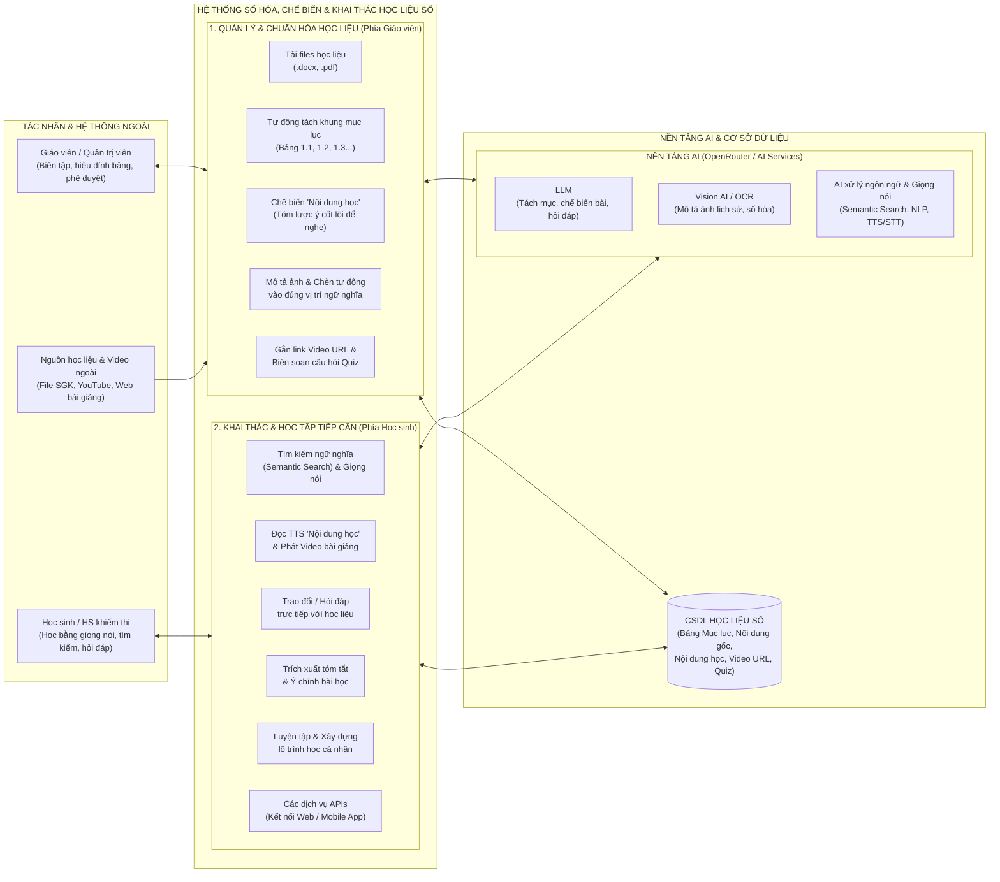
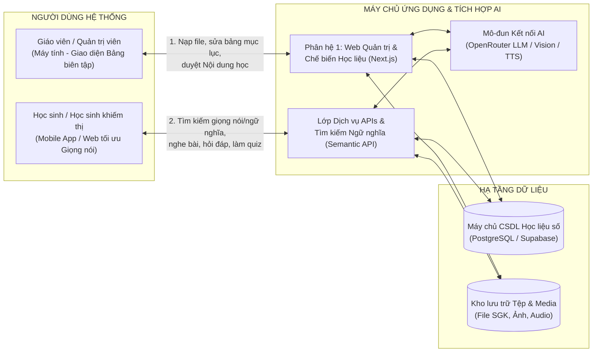

# Thuyết minh & Thiết kế hệ thống: Ứng dụng AI xây dựng Kho học liệu số hỗ trợ học sinh và học sinh khiếm thị

> [!NOTE]
> Tài liệu này được biên soạn theo đúng cấu trúc mẫu thuyết minh `2025_09_AI Thu vien_Thuyet minh_V2.docx` của thầy và cụ thể hóa toàn bộ các chỉ dẫn chuyên môn của thầy trong buổi trao đổi trực tiếp (`Bản ghi Mới.m4a`).

---

## 1. Tên đề tài / Định hướng nghiên cứu

**Nghiên cứu ứng dụng AI hỗ trợ tự động cấu trúc hóa, chế biến học liệu số và xây dựng hệ thống học tập tiếp cận cho học sinh khiếm thị (Minh họa môn Lịch sử lớp 12).**

---

## 2. Luận giải về những nội dung cần nghiên cứu của đề tài

Trong xây dựng kho học liệu số phục vụ học sinh phổ thông, đặc biệt là học sinh mù và khiếm thị, việc chuyển đổi từ sách giáo khoa truyền thống sang học liệu có thể nghe và tương tác hiệu quả là bài toán có ý nghĩa quyết định. Sách giáo khoa hiện hành được thiết kế tối ưu cho người sáng mắt với văn bản dài, bố cục nhiều cột, bảng biểu và nhiều hình ảnh, lược đồ minh họa. Nếu chỉ số hóa thô và dùng phần mềm đọc màn hình đọc nguyên văn từ đầu đến cuối, học sinh khiếm thị sẽ gặp ba rào cản lớn:
1. **Khó định vị cấu trúc bài học:** Không nắm được nhanh khung mục lục phân cấp (bài học gồm mấy mục lớn, mấy tiểu mục) để điều hướng hoặc chọn phần cần học.
2. **Quá tải thông tin khi nghe thụ động:** Nghe đọc nguyên văn sách giáo khoa dài dòng làm giảm khả năng ghi nhớ; người học cần một bản **"Nội dung học"** đã được chắt lọc các ý cốt lõi tương tự như lời giảng cô đọng của giáo viên trên lớp.
3. **Mất thông tin trực quan từ hình ảnh/tư liệu lịch sử:** Các bức ảnh lịch sử trong sách chứa bối cảnh và thông tin quan trọng nhưng người khiếm thị không nhìn thấy; nếu chỉ đặt chú thích ảnh rời rạc ở cuối bài, luồng nghe sẽ bị đứt gãy.

Khi ứng dụng Trí tuệ nhân tạo (AI) kết hợp với sự kiểm duyệt của giáo viên (*Human-in-the-loop*), hệ thống sẽ tự động tách khung mục lục bài học từ tài liệu gốc ra cấu trúc bảng chuẩn, chế biến **"Nội dung gốc (SGK)"** thành **"Nội dung học (bản đọc cho người mù)"**, đồng thời dùng AI mô tả hình ảnh và **tự động tìm vị trí ngữ nghĩa phù hợp trong đoạn văn để chèn lời mô tả ảnh vào đúng mạch bài giảng**. Bên cạnh đó, việc trích xuất từ khóa ngữ nghĩa, câu hỏi luyện tập và liên kết video bài giảng giúp học sinh khiếm thị có thể tìm kiếm bài học bằng ngôn ngữ tự nhiên (giọng nói), trao đổi trực tiếp với học liệu và xây dựng lộ trình học cá nhân hóa.

---

### PHIẾU HỌC LIỆU SỐ CHUẨN HÓA (MINH HỌA ĐẦU RA CỦA HỆ THỐNG)

#### 1. THÔNG TIN CHUNG VỀ HỌC LIỆU
- **Môn học / Cấp lớp:** Lịch sử – Lớp 12 (Bộ sách: Kết nối tri thức với cuộc sống)
- **Chủ đề 1:** Thế giới trong và sau Chiến tranh lạnh
- **Bài học minh họa:** Bài 1 – Liên hợp quốc *(và trích đoạn minh họa chèn ảnh ngữ nghĩa từ Bài 6 – Cách mạng tháng Tám năm 1945)*
- **Định dạng lưu trữ CSDL:** Bảng cấu trúc phân cấp (`Course` → `Lesson` → `Section Table 1.1, 1.2...`)

#### 2. BẢNG CẤU TRÚC MỤC LỤC & NỘI DUNG DO AI TÁCH TỰ ĐỘNG (ĐÃ QUA GIÁO VIÊN HIỆU ĐÍNH)

| Mã mục | Tiêu đề mục chuẩn hóa | Nội dung gốc (Từ SGK - Để tham chiếu) | Nội dung học (AI chế biến để đọc cho người khiếm thị + Đã chèn mô tả ảnh) | Link Video bài giảng (URL) | Câu hỏi luyện tập (Quiz) |
| :--- | :--- | :--- | :--- | :--- | :--- |
| **1.1** | Một số vấn đề cơ bản về Liên hợp quốc: Bối cảnh lịch sử và quá trình hình thành | Văn bản gốc SGK trang 7–8 + Hình 1 (Hội nghị I-an-ta) + Hình 2 (Lễ ký Hiến chương tại Xan Phran-xi-xcô). | **Ý chính 1 (Bối cảnh):** Cuối Chiến tranh thế giới thứ hai, các nước Đồng minh nhận thấy cần hợp tác để tiêu diệt chủ nghĩa phát xít và duy trì hòa bình sau chiến tranh. **Ý chính 2 (Quá trình hình thành):** Trải qua các hội nghị quốc tế lớn từ 1941 đến 1945. Đặc biệt tại Hội nghị I-an-ta (tháng 2/1945), nguyên thủ ba nước Liên Xô, Mỹ, Anh đã thống nhất thành lập Liên hợp quốc. *[Mô tả ảnh chèn tự động: Trong bức ảnh tư liệu chụp tại Hội nghị I-an-ta, ba nhà lãnh đạo Xta-lin, Ru-dơ-ven và Sơc-sin ngồi hàng ghế đầu trong khuôn viên Cung điện Li-va-đi-a, thể hiện sự đồng thuận của ba cường quốc Đồng minh trước thời điểm chiến tranh kết thúc].* **Ý chính 3 (Thành lập):** Ngày 24/10/1945, Hiến chương chính thức có hiệu lực sau khi 50 nước ký kết tại Xan Phran-xi-xcô. | `https://youtube.com/...` *(hoặc URL từ cổng học tập bất kỳ)* | 03 câu hỏi trắc nghiệm mức Nhận biết – Thông hiểu gắn với mục 1.1 |
| **1.2** | Mục tiêu và nguyên tắc hoạt động của Liên hợp quốc | Văn bản gốc SGK trang 8–9 + Bảng các nguyên tắc hoạt động theo Điều 1, Điều 2 Hiến chương. | **Ý chính 1 (4 Mục tiêu cốt lõi):** (1) Duy trì hòa bình và an ninh quốc tế — đây là mục tiêu trọng tâm nhất; (2) Thúc đẩy quan hệ hữu nghị giữa các dân tộc; (3) Hợp tác quốc tế giải quyết các vấn đề kinh tế, xã hội, văn hóa, nhân đạo; (4) Là trung tâm điều hòa nỗ lực chung của các quốc gia. **Ý chính 2 (Nguyên tắc hoạt động):** Tôn trọng bình đẳng chủ quyền quốc gia, toàn vẹn lãnh thổ; không can thiệp công việc nội bộ; giải quyết tranh chấp bằng biện pháp hòa bình; chung sống hòa bình và sự nhất trí của 5 nước ủy viên thường trực. | `https://...` | 04 câu hỏi trắc nghiệm gắn với mục 1.2 |
| **1.3** | Vai trò của Liên hợp quốc trong duy trì hòa bình, an ninh quốc tế | Văn bản gốc SGK trang 9–10. | **Ý chính 1:** Ngăn ngừa không để xảy ra một cuộc chiến tranh thế giới mới từ năm 1945 đến nay. **Ý chính 2:** Xây dựng hệ thống các công ước quốc tế về giải trừ quân bị, chống chạy đua vũ trang và hạn chế vũ khí hạt nhân. **Ý chính 3:** Thúc đẩy quá trình phi thực dân hóa, thủ tiêu hệ thống thuộc địa. | `https://...` | 03 câu hỏi trắc nghiệm gắn với mục 1.3 |
| **1.4** | Vai trò của Liên hợp quốc trong thúc đẩy phát triển và bảo đảm quyền con người | *(Giáo viên tách từ mục lớn trong SGK thành mục 1.4 riêng trên bảng để bài nghe ngắn gọn, vừa sức học sinh khiếm thị)* | **Ý chính 1 (Phát triển):** Đề ra Chương trình nghị sự 2030 với 17 Mục tiêu phát triển bền vững (SDGs), hỗ trợ các nước đang phát triển về vốn, tri thức. **Ý chính 2 (Quyền con người & Văn hóa):** Thông qua Tuyên ngôn Nhân quyền (1948), bảo vệ quyền phụ nữ, trẻ em và bảo tồn di sản văn hóa thế giới (qua UNESCO). | `https://...` | 03 câu hỏi trắc nghiệm gắn với mục 1.4 |

#### 3. MINH HỌA CƠ CHẾ AI MÔ TẢ ẢNH & TỰ ĐỘNG CHÈN THEO NGỮ NGHĨA (SEMANTIC INSERTION)
*(Ví dụ trích đoạn từ Bài 6: Cách mạng tháng Tám năm 1945 – Mục 6.1: Bối cảnh và quá trình chuẩn bị khởi nghĩa)*

- **Dữ liệu gốc trong SGK:**
  + *Văn bản gốc:* "Chiều ngày 16-8-1945, theo lệnh của Ủy ban Khởi nghĩa toàn quốc, một đơn vị Giải phóng quân do Võ Nguyên Giáp chỉ huy xuất phát từ Tân Trào tiến về giải phóng thị xã Thái Nguyên, mở đầu cho Tổng khởi nghĩa vũ trang giành chính quyền trong cả nước."
  + *Hình ảnh đính kèm:* Ảnh tư liệu lễ xuất quân dưới bóng cây đa Tân Trào (Tuyên Quang).
- **Quá trình AI xử lý 2 bước:**
  + *Bước 1 (AI Mô tả ảnh trong bối cảnh lịch sử):* "Hình ảnh tư liệu tại cây đa Tân Trào (Tuyên Quang) tháng 8 năm 1945 ghi lại cảnh đội hình các chiến sĩ Giải phóng quân đứng trang nghiêm dưới tán cây đa cổ thụ, lắng nghe đọc Quân lệnh số 1 trước giờ xuất quân."
  + *Bước 2 (AI phân tích ngữ nghĩa để chọn vị trí chèn):* Hệ thống xác định vị trí chèn tự nhiên nhất là **ngay sau câu nói về sự kiện xuất phát từ Tân Trào chiều 16/8/1945** để người mù hình dung được ngay không khí lịch sử tại thời điểm đó trước khi nghe tiếp diễn biến ở các tỉnh khác.
- **Kết quả "Nội dung học" để TTS đọc cho học sinh khiếm thị:**
  > *"Ý chính tiếp theo là lệnh xuất quân tại Tân Trào: Chiều ngày 16 tháng 8 năm 1945, theo lệnh của Ủy ban Khởi nghĩa toàn quốc, đơn vị Giải phóng quân do đồng chí Võ Nguyên Giáp chỉ huy đã làm lễ xuất phát từ Tân Trào tiến về giải phóng thị xã Thái Nguyên. Hình ảnh tư liệu tại cây đa Tân Trào ghi lại cảnh đội hình các chiến sĩ Giải phóng quân đứng trang nghiêm dưới tán cây đa cổ thụ, lắng nghe Quân lệnh số 1 trước giờ lên đường, mở đầu cho Tổng khởi nghĩa giành chính quyền trên cả nước."*

---

## 4. Kiến trúc các thành phần của hệ thống (Hình 1)

---

## 5. Mô hình triển khai hệ thống và vai trò người dùng (Hình 2)

